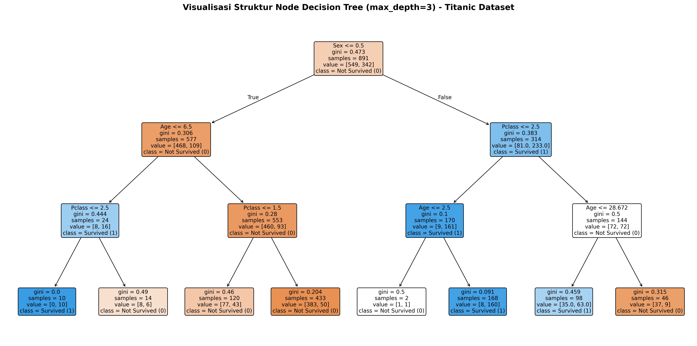

# 🌳 Praktikum Decision Tree Classifier - Titanic Dataset

Repositori ini berisi pengerjaan tugas dan latihan **Pertemuan 6 Mata Kuliah Web Data Mining**, yang berfokus pada pemodelan klasifikasi menggunakan algoritma **Decision Tree (Pohon Keputusan)** pada dataset Titanic menggunakan library **Scikit-Learn**, **Pandas**, dan visualisasi grafik dengan **Matplotlib**.

---

## 📁 Struktur Direktori

```text
Tugas 5/
├── data/
│   ├── titanic.csv                  # Dataset training
│   ├── titanic_test.csv             # Dataset pengujian (fitur)
│   └── titanic_testlabel.csv        # Ground truth label data uji
├── jawaban/
│   ├── decision_tree_classifier.py  # Pemodelan, evaluasi komparatif, dan visualisasi pohon
│   ├── decision_tree.png            # Grafik visual pohon keputusan (300 DPI)
│   └── decision_tree.dot            # Struktur graphviz pohon keputusan
└── README.md
```

---

## 📋 Ringkasan Pengerjaan

| File Jawaban | Topik | Penjelasan Singkat |
| :--- | :--- | :--- |
| [`decision_tree_classifier.py`](jawaban/decision_tree_classifier.py) | **Decision Tree Classification & Visualisasi Node** | Melakukan preprocessing data (mapping gender, imputasi missing value berbasis kelas), pelatihan Decision Tree dengan *pre-pruning* (`max_depth=3`), perbandingan dinamis akurasi, serta ekspor struktur node dalam format teks dan diagram gambar (`.png`). |

---

## 🔬 Perbandingan Sebelum vs Sesudah Penyederhanaan (*Pruning*)

Secara default, algoritma Decision Tree akan memecah cabang terus menerus hingga seluruh daun murni (*pure leaf*), yang menyebabkan **overfitting** dan menghasilkan diagram node yang sangat rumit. Dengan membatasi kedalaman maksimum (`max_depth=3`), model menjadi jauh lebih sederhana dan kemampuan generalisasinya meningkat pesat:

| Metrik / Parameter | Tanpa Pruning (`max_depth=None`) | Disederhanakan (`max_depth=3`) | Keterangan |
| :--- | :---: | :---: | :--- |
| **Total Jumlah Node** | 381 node | **15 node** | Struktur sangat ringkas & mudah dipahami |
| **Kedalaman Pohon (*Depth*)** | 19 level | **3 level** | Cabang keputusan terfokus |
| **Jumlah Daun (*Leaves*)** | 191 daun | **8 daun** | Aturan klasifikasi jelas |
| **Akurasi Data Latih (*Train Acc*)** | 98.77% | 82.94% | Mencegah hafalan data (*overfit*) |
| **Akurasi Data Uji (*Test Acc*)** | 77.03% | **90.43%** | 🚀 **Meningkat +13.40%** |
| **Error Ratio Data Uji** | 22.97% | **9.57%** | Kesalahan prediksi berkurang signifikan |

---

## 🌟 Visualisasi Struktur Node Pohon Keputusan

Berikut adalah diagram pohon keputusan yang dihasilkan secara otomatis:



---

## 🌳 Aturan Logika Keputusan (*Decision Rules*)

```text
|--- Sex <= 0.50 (Laki-laki)
|   |--- Age <= 6.50 (Anak-anak)
|   |   |--- Pclass <= 2.50 (Kelas 1 / 2) -> class: 1 (Selamat)
|   |   |--- Pclass >  2.50 (Kelas 3)     -> class: 0 (Tidak Selamat)
|   |--- Age >  6.50 (Dewasa / Remaja)
|   |   |--- Pclass <= 1.50 -> class: 0 (Tidak Selamat)
|   |   |--- Pclass >  1.50 -> class: 0 (Tidak Selamat)
|--- Sex >  0.50 (Perempuan)
|   |--- Pclass <= 2.50 (Kelas 1 / 2)
|   |   |--- Age <= 2.50 -> class: 0 (Tidak Selamat)
|   |   |--- Age >  2.50 -> class: 1 (Selamat)
|   |--- Pclass >  2.50 (Kelas 3)
|   |   |--- Age <= 28.67 -> class: 1 (Selamat)
|   |   |--- Age >  28.67 -> class: 0 (Tidak Selamat)
```
